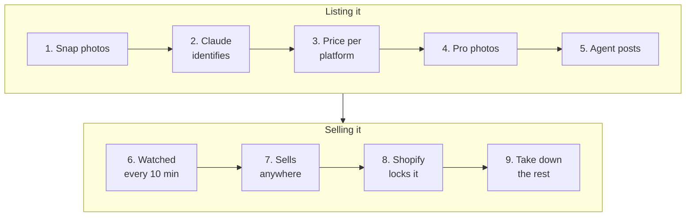
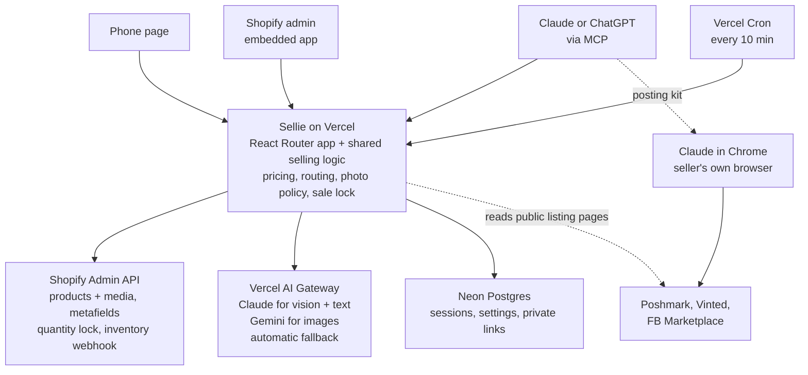

# Sellie

**Snap a photo. An AI agent lists it everywhere it sells best, and takes it down everywhere else the moment it sells.**

Sellie is an agentic selling tool for people clearing out a closet, not running a business. You take a few photos with your phone and set the least you'd take home. Sellie does the rest:

- **Identifies the item** from the photos: brand, model, size, condition, and what it's worth.
- **Turns phone snaps into listing photos**: real photos corrected and cut out onto a studio background, plus labeled AI product and model shots. Every edited image is checked for honesty (same color, details and wear) before a buyer sees it.
- **Picks where to sell**: clothes go to Poshmark and Vinted; chairs, power banks and other bulky or electronic items go to Facebook Marketplace for local pickup.
- **Prices each marketplace backward from your floor**, so after fees, shipping and the usual offer haggling you still keep what you asked for.
- **Writes a listing per platform, tuned for how buyers search there (SEO and GEO)**: the keywords and title format each platform's search favors (eBay's keyword-dense 80 characters, Depop's style hashtags, plain "what it is" titles for FB local buyers), within its length limits. Descriptions are written in clear, complete sentences so AI shopping assistants can quote them accurately.
- **Posts for you**: an AI agent (Claude, through Sellie's MCP server and Claude in Chrome) fills in each marketplace's form in your own signed-in browser and publishes it. The item also goes live on your Shopify store.
- **Keeps one item from selling twice**: Shopify is the inventory record. When the item sells anywhere, its quantity drops to 0 and every other listing is flagged to take down.

**Try it on your phone: [https://sellie-dusky.vercel.app/s/sISLse5CkkWFtW5ZgBRS8ATUQ_pct6KF](https://sellie-dusky.vercel.app/s/sISLse5CkkWFtW5ZgBRS8ATUQ_pct6KF)**

The app runs on Vercel: a Shopify app, this phone web page and an MCP endpoint.

**Demo videos**
- [Sellie demo (YouTube Short)](https://youtube.com/shorts/wWNxYnjX3Fc)
- [The agent posting a listing to Poshmark (Loom)](https://www.loom.com/share/e17df555398c4667b319f074b198831e)

## How it works



| Step | What happens |
|---|---|
| 1. Snap photos | On the phone page; saved as a private Shopify draft product |
| 2. Claude identifies | Brand, size, condition and value, via Vercel AI Gateway |
| 3. Price per platform | Picks marketplaces by category; prices each back from your take-home floor |
| 4. Pro photos | Real-pixel studio cutout + Gemini renders, each honesty-checked by Claude |
| 5. Agent posts | Claude reads the posting kit over MCP and fills in Poshmark, Vinted or FB with Claude in Chrome |
| 6. Watched | Vercel Cron checks every live listing every 10 minutes |
| 7. Sells anywhere | The listing page says sold out, or a Shopify checkout fires the inventory webhook |
| 8. Shopify locks it | Quantity 1 → 0, so it can't sell twice |
| 9. Take down the rest | Every other listing is flagged; the agent or you take them down |



**Where Shopify fits:** each item is a Shopify product, kept private until it's put on the store. Photos are product media. Everything Sellie learns is stored in app metafields: item details, floor, per-platform listings, where it's live, photo kinds and the AI trace. Shopify quantity is the lock.

**How a sale syncs back:** marketplaces publish schema.org product data on listing pages, and its `availability` flips from `InStock` to `SoldOut` when the item sells. A Vercel Cron job checks every live listing every 10 minutes ([availability.ts](packages/core/src/availability.ts)). A checkout on your Shopify store arrives instantly through the `inventory_levels/update` webhook. Either way the same sale lock runs: quantity goes to 0 and the other listings are flagged "take down". The phone page also has a **Check for sales** button, and the AI assistant has a `check_sales` tool.

## Models, routing and fallbacks (Vercel AI Gateway)

There are three model paths:

- **photos → text:** item details, photo grades, honesty verdicts.
- **photos → photos:** item cutout masks, AI product and model shots.
- **text → text:** listings.

All calls go through Vercel AI Gateway. The routing table lives in [models.ts](packages/agents/src/models.ts).

| Task | In → out | Primary | Backups | Why |
|---|---|---|---|---|
| Identify item | photos → details | Claude Opus 5.5 | Sonnet 5.5 → Opus 5 | Reading tags right sets the price; once per item |
| Grade photos | photos → scores | Claude Haiku 5.5 | Sonnet 5.5 | Simple call; ~40× cheaper than Opus, fastest |
| Write listings | text → text | Claude Sonnet 5.5 | Haiku 5.5 → Opus 5.5 | Good copy at half Opus price, faster |
| Honesty check | photos → verdict | Claude Sonnet 5.5 | Opus 5.5 | Runs per edited image; must be reliable |
| Item outline | photo → mask | Nano Banana 2.1 | Gemini 3.1 Flash Image → 2.5 Flash Image | B/W output; cheapest and fastest (~$0.03) |
| AI product / model photo | photos → photo | Nano Banana Pro | Nano Banana 2.1 → 3.1 Flash Image | Buyer-facing, most faithful (~$0.13) |

**When a provider fails:**
1. The Gateway first tries the same model on another provider. For Claude that's Anthropic → Vertex → Bedrock; for Gemini, Google → Vertex.
2. Then it moves to the next model in the list (`providerOptions.gateway.models` + `order`).
3. Backup image renders still have to pass the honesty check (accuracy, plus a stock-quality score of at least 7/10), so a weaker fallback can't put a misleading photo in a listing.
4. If a step fails entirely, the item keeps the seller's own corrected photos.

**Seeing it:** every call's answering model, provider, latency and cost (from the Gateway's routing metadata) is saved on the item and shown on the phone page under **AI used for this item**. The **simulate an outage** switch replaces each primary model ID with one that doesn't exist, so the Gateway really fails it and really falls back. Example: listings normally on Sonnet 5.5 (4.1 s, $0.0055); with the outage, Haiku 5.5 answered (2.6 s, $0.0002).

**Photo honesty, per platform:** Vinted, Depop and eBay keep a real photo as the cover. Poshmark, Mercari, FB and the Shopify store may lead with a labeled AI product shot when no real-photo studio shot passes the quality bar. Any listing with AI images gets a disclosure line ([photos.ts](packages/core/src/photos.ts)).

## For judges

Open the demo phone link on your phone or a desktop browser: [https://sellie-dusky.vercel.app/s/sISLse5CkkWFtW5ZgBRS8ATUQ_pct6KF](https://sellie-dusky.vercel.app/s/sISLse5CkkWFtW5ZgBRS8ATUQ_pct6KF)

**1. List something (about 2 minutes)**
1. Open the demo link. Tap **Take photo** or **Choose photos** and add 1–4 photos of anything: a jacket, shoes, a cap, a mouse, a chair. Include the tag if it has one.
2. Enter a number under **Least you want to keep after fees** (e.g. 10), then tap **Sell this**.
3. Watch it work: **What we found** fills in (Claude identifies the item), then **Where it sells best** shows each marketplace with its price and what you'd keep, and the listings are written. In parallel, **Photos** fills with the studio cutout and the AI shots. Any shot that failed the honesty check is listed with the reason.

**2. See the model routing and a failover**
1. Scroll to **AI used for this item**. Each step shows which model answered, on which provider, how long it took and what it cost.
2. Tick **Demo: simulate an outage of every primary model**, then tap **Redo AI photos** (or add another item). The new rows show the primary failing and a backup answering, with the cost difference.

**3. Sell it, and watch it lock**
1. On two marketplace cards (e.g. Poshmark and Vinted), tap **I posted it**. The link is optional.
2. Under **Sold it?**, tap **Sold on Poshmark**.
3. The item locks: Shopify quantity drops to 0, and **Take these down now** lists the other marketplace with a link. In real use the 10-minute sale check (or a Shopify store checkout) does this for you, with no tapping.

**4. The agent posting ([watch on Loom](https://www.loom.com/share/e17df555398c4667b319f074b198831e))**
Posting to Poshmark, Vinted and FB happens in the seller's own signed-in browser, so judges see it in the video rather than live. Claude reads the item's posting kit over MCP (title, description, price, photos in order, offer floor), fills in the marketplace form with Claude in Chrome, publishes it, and saves the listing link back to Sellie. From then on the 10-minute sale check watches that listing.

Something stuck? Reload the page: every step saves to Shopify as it finishes, so nothing is lost. The **Check for sales** button on the home page runs the marketplace sale check on demand.

## Layout

| Path | What |
|---|---|
| `packages/core` | Channel profiles, fees, pricing, routing, photo policy, sale detection, inventory interface, sale logic. No dependencies; tested (`npm test`). |
| `packages/agents` | AI steps: identify, grade photos, write listings, image cutout and renders, honesty check. Model routing and tracing in `models.ts`. |
| `apps/shopify` | Public Shopify app (React Router, Polaris, Prisma/Postgres) on Vercel: admin screens, the phone page, the MCP endpoint, the sale-check cron and webhooks. |

## Run locally

You need:
- Node 24+
- the [Shopify CLI](https://shopify.dev/docs/api/shopify-cli) (`npm i -g @shopify/cli`)
- a Shopify Partner account with a development store
- Postgres

```bash
npm install
npm test                              # core logic tests
createdb agentic_selling              # or use a Neon database
cd apps/shopify
echo 'DATABASE_URL=postgresql://localhost:5432/agentic_selling' > .env
npm run dev                           # shopify app dev: links the app, opens a tunnel, installs on your dev store
```

To try the assistant flow: in the app, open **Connect AI**, create a link, and add it as a custom connector in Claude (Settings → Connectors) or ChatGPT (Developer mode).

CLI-only intake (no Shopify): `npm run intake -- --floor 40 photos/*.jpg` from the repo root.

## Deploy (Vercel)

1. Import the repo in Vercel, root directory `apps/shopify` (framework: React Router; build command `npm run vercel-build`).
2. Add a Neon Postgres database from the Vercel Marketplace (sets `DATABASE_URL`).
3. Set these variables:
   - `SHOPIFY_API_KEY`, `SHOPIFY_API_SECRET`
   - `SCOPES` (same list as `shopify.app.toml`)
   - `SHOPIFY_APP_URL` (the Vercel URL)
   - `AI_GATEWAY_API_KEY`
   - `CRON_SECRET` (protects the sale-check cron)
4. Point the app at the Vercel URL in `shopify.app.toml` (`application_url`, redirect URLs) and run `shopify app deploy` to push config, webhooks and metafield definitions.

### Demo store setup

1. `shopify app deploy`, then open the app once in the store admin to approve new scopes.
2. Turn on test payments (**Settings → Payments**: Shopify's Bogus Gateway, or Shopify Payments in test mode). If you use Shopify Payments, set `DEMO_TEST_CARD` to its test card.
3. In **Connect AI**, make two links: one for judges and one for you. On Vercel, set two variables:
   - `DEMO_PRESENTER_KEY`: your link's key. Only that link shows **Reset demo**, which archives every product in the store.
   - `STOREFRONT_PASSWORD`: the dev store's storefront password, shown next to the store link.

The take-down list only includes marketplaces the item was posted on. For the full story, post one item to Poshmark, Vinted and FB beforehand (or tap **I posted it**).

## Before public launch

- Replace secret connection links with OAuth sign-in for the MCP endpoint (`withMcpAuth` from mcp-handler).
- Price from each marketplace's own sold comps (e.g. Poshmark's similar-sold average), not one estimate.
- Instant sale detection from marketplace "you made a sale" emails, alongside the 10-minute check.
- Shopify App Store review: billing through the Shopify Billing API, listing assets, privacy policy.
- Check every fee in `fees.ts` against real payouts.
- eBay production API keys and OAuth per seller.

## Known risks

- Poshmark, Vinted and FB have no listing API for individuals. The agent posts by driving the seller's own browser, with the seller signed in and watching. Sellie never sees or stores marketplace passwords. Automated posting may still conflict with a marketplace's terms, so the seller can always post from the copy-ready kit by hand instead.
- Double sales on one-of-one items: the Shopify lock is instant, but a marketplace sale is seen within 10 minutes, and taking the other listings down depends on the agent or the seller acting on the reminder.
- Sale detection reads public listing pages. If a marketplace changes or hides its product data, that listing reads as "unknown" and nothing changes. Poshmark's sold signal is verified; Vinted's isn't yet.
